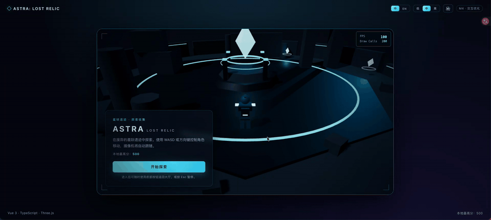

# ASTRA: Lost Relic

**[在线体验](https://gamedemo-web3d-01.pages.dev)** · 无需安装，浏览器直接打开



基于 Vue 3 + TypeScript + Three.js 的第三人称 3D 探索收集小游戏。玩家在废弃的星际遗迹中操控机器人，在倒计时结束前收集全部能量晶体。已完成 **M0–M4**：工程骨架、Three.js Runtime、移动与摄像机、玩法闭环、UI 与移动端适配。

## 玩法

- 单局 **120 秒**，场景内散布 **5 个能量晶体**，每个 **100 分**。
- 走近晶体即可收集，同一个晶体只计分一次。
- 集齐 5 个晶体 → 任务完成；倒计时归零 → 任务失败。
- 结算后展示最终得分、收集数量与本地最高分，可直接重开。
- 最高分保存在 `localStorage`，仅为**本机记录**，不上传服务端。

## 操作

| 输入         | 行为                                   |
| ------------ | -------------------------------------- |
| `W` / `↑`    | 前进                                   |
| `S` / `↓`    | 后退                                   |
| `A` / `←`    | 左移                                   |
| `D` / `→`    | 右移                                   |
| `Esc`        | 暂停 / 继续                            |
| 触屏左下摇杆 | 拖动控制移动方向                       |
| 顶栏按钮     | 切换画质（低 / 中 / 高）、静音、中英文 |

对角线方向自动归一化，切换标签页会自动暂停并释放输入。

## 技术栈

- Vue 3（Composition API + `<script setup>`）
- TypeScript（严格模式）
- Vite
- Three.js（`@types/three` 提供类型）
- Vitest（逻辑与状态机单测）
- ESLint + Prettier
- Cloudflare Pages（静态部署）

## 环境要求

- Node.js >= 20.19
- npm >= 10

## 常用命令

| 命令                    | 说明                                          |
| ----------------------- | --------------------------------------------- |
| `npm install`           | 安装依赖                                      |
| `npm run dev`           | 启动开发服务器（默认显示性能面板，`F2` 折叠） |
| `npm run build`         | 类型检查并生成生产构建（`dist/`）             |
| `npm run preview`       | 本地预览生产构建                              |
| `npm run typecheck`     | 执行 `vue-tsc` 类型检查                       |
| `npm run lint`          | ESLint 检查（`--max-warnings=0`）             |
| `npm run lint:fix`      | ESLint 自动修复                               |
| `npm run test`          | Vitest 单测（7 个文件 / 79 个用例）           |
| `npm run test:coverage` | 生成覆盖率报告                                |
| `npm run format`        | Prettier 格式化                               |
| `npm run format:check`  | Prettier 格式校验                             |

## 目录结构

```text
.
├── docs/
│   └── demo.gif                       # README 演示视频
├── src/
│   ├── components/
│   │   ├── GameMenu.vue               # 游戏大厅
│   │   ├── GameViewport.vue           # 画布容器与 Runtime 生命周期
│   │   └── TouchControls.vue          # 触屏虚拟摇杆
│   ├── game/
│   │   ├── audio/AudioManager.ts      # Web Audio 合成音效、静音与 unlock
│   │   ├── config/
│   │   │   ├── gameConfig.ts          # 时长、晶体位置、分值与收集判定
│   │   │   ├── movement.ts            # 玩家速度、半径、转向与出生点
│   │   │   └── qualityConfig.ts       # 低/中/高画质预设
│   │   ├── core/
│   │   │   ├── GameRuntime.ts         # Renderer/Scene/Camera/循环/resize/destroy
│   │   │   └── GameSession.ts         # 状态机、计时器、计分与规则
│   │   ├── entities/
│   │   │   ├── Collectible.ts         # 能量晶体模型与 idle 动画
│   │   │   └── Player.ts              # 玩家模型、位置、朝向与动画
│   │   ├── input/
│   │   │   ├── InputManager.ts        # 键盘 + 触控归一化输入
│   │   │   ├── KeyboardInput.ts       # WASD/方向键，失焦重置
│   │   │   └── TouchInput.ts          # 摇杆向量输出
│   │   ├── scene/
│   │   │   ├── arenaLayout.ts         # 场地尺寸与障碍碰撞数据
│   │   │   └── createWorld.ts         # 遗迹场景、材质与灯光
│   │   ├── systems/
│   │   │   ├── CameraFollowSystem.ts  # 第三人称阻尼跟随
│   │   │   ├── CollectionSystem.ts    # 收集检测与回调
│   │   │   ├── MovementSystem.ts      # delta 移动、碰撞与朝向
│   │   │   ├── OcclusionSystem.ts     # 遮挡体透明淡出
│   │   │   └── collision.ts           # 纯函数：边界、圆/AABB 碰撞与滑动
│   │   └── utils/
│   │       ├── HighScoreStorage.ts    # localStorage 最高分
│   │       └── disposeScene.ts        # geometry/material/texture 释放
│   ├── styles/main.css                # 全局设计变量与基础样式
│   ├── types/game.ts                  # 状态、命令与事件类型
│   ├── App.vue                        # 页面布局、HUD、菜单与结算 overlay
│   ├── i18n.ts                        # 中英文文案
│   └── main.ts
├── tests/                             # Vitest 单测（collision/session/input/audio...）
├── index.html
├── env.d.ts
├── eslint.config.js
├── .prettierrc.json
├── vite.config.ts
├── tsconfig.json
├── plan_game.md                       # 项目开发规范与里程碑
└── README.md
```

## 架构约定

- **Vue 层**：页面布局、菜单、HUD、结算与暂停弹窗、加载/错误状态和低频业务状态。
- **Three.js Runtime 层**：`GameRuntime` 统一持有 Renderer、Scene、Camera、渲染循环和资源释放；Vue 组件只负责容器与生命周期。
- 两层通过 `GameCommand` 下行、`GameEvent` 上行通信；每帧高频数据不写入 Vue 响应式状态。
- 输入 / 移动 / 摄像机 / 收集四套系统互相独立：`InputManager` 只输出方向，`MovementSystem` 读写 `Player` 并做碰撞，`CameraFollowSystem` 只读角色位置，`CollectionSystem` 只做距离判定。
- 规则集中：时长、分值、晶体位置在 `config/gameConfig.ts`，画质档位在 `config/qualityConfig.ts`，不在系统代码里散落硬编码。
- 移动使用 `deltaSeconds` 与指数平滑，帧率无关；可行走区为 16 边形半平面交集，障碍使用圆形与旋转 AABB 近似，碰撞后沿边缘推出。
- 摄像机采用固定世界偏移（角色后上方）+ 指数阻尼，不挂在角色节点下。
- 运行时按画质档位限制 `devicePixelRatio`（1 / 1.5 / 2）并控制阴影与雾效；`destroy()` 可重复调用并释放场景资源。
- 音效由 Web Audio API 实时合成，不依赖外部音频文件；`AudioContext` 在首次用户交互后才激活。

## 里程碑状态

| 里程碑 | 内容                               | 状态     |
| ------ | ---------------------------------- | -------- |
| M0     | 工程骨架                           | 完成     |
| M1     | Three.js Runtime                   | 完成     |
| M2     | 玩家移动与摄像机                   | 完成     |
| M3     | 玩法闭环（收集/计时/计分/结算）    | 完成     |
| M4     | UI 与移动端（摇杆/画质/静音/双语） | 完成     |
| M5     | 资产接入（GLB 替换几何体）         | 未开始   |
| M6     | 性能、清理与测试                   | 部分完成 |
| M7     | 部署与交付                         | 部分完成 |

## 已知限制

- **尚未接入外部模型 / 纹理**，场景与角色全部由基础几何体拼装，`public/` 目录仍为空。
- 性能面板与 FPS 统计已内置，但**尚未产出真实设备上的测量记录**，`docs/performance-notes.md` 未创建。
- 边界墙、灯带、碎石、祭坛立柱等重复物体仍是独立 `Mesh`，未合并为 `InstancedMesh`。
- 生产构建单 chunk 约 653 kB（gzip 约 175 kB），主要来自 Three.js，尚未做代码分割。
- 障碍碰撞使用圆形 / 旋转 AABB 近似，复杂或不规则建筑需要更精细的碰撞体。
- 摄像机为固定世界偏移的后上方跟随，不支持鼠标环绕或自由视角。
- 单测覆盖纯逻辑与状态机，尚无 E2E 用例覆盖"开始 → 游玩 → 结算 → 重开"完整链路。
- 暂无 `docs/asset-inventory.md`（M5 引入资产时同步补充来源与许可）。

## 部署

静态站点，无后端依赖。

- 构建命令：`npm run build`
- 输出目录：`dist`
- 托管：Cloudflare Pages，线上地址 <https://gamedemo-web3d-01.pages.dev>
